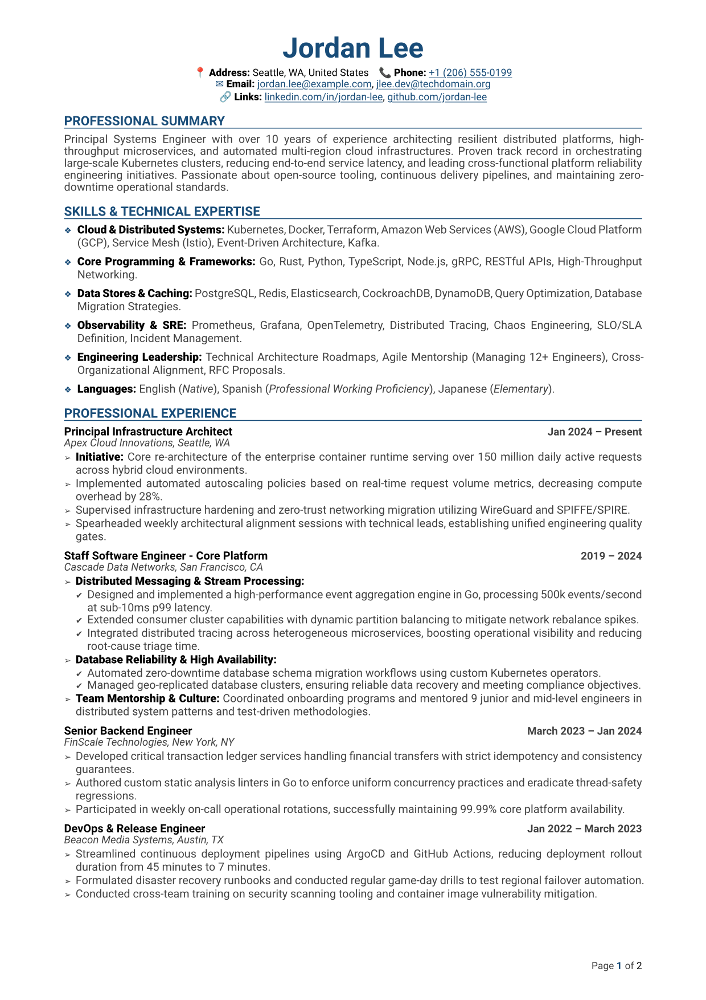
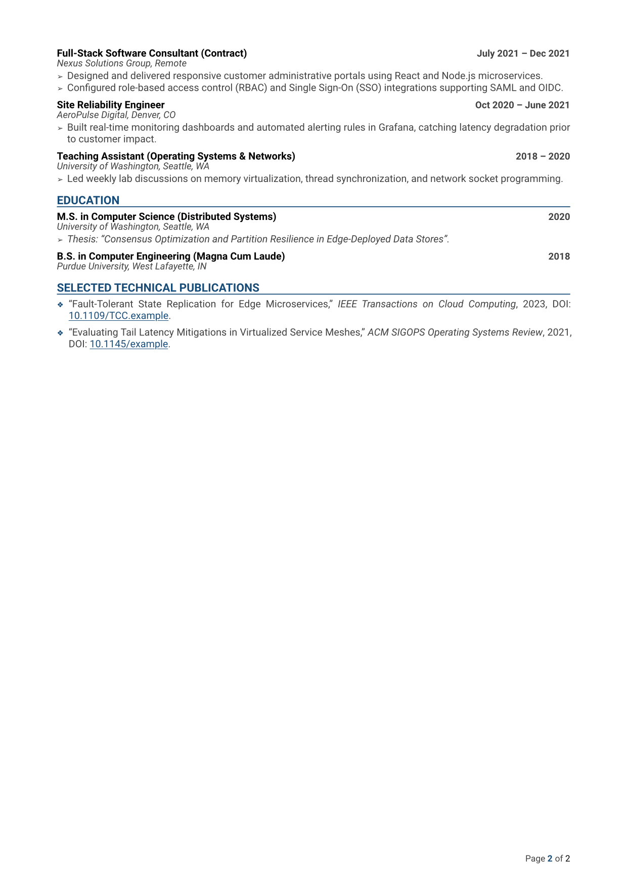
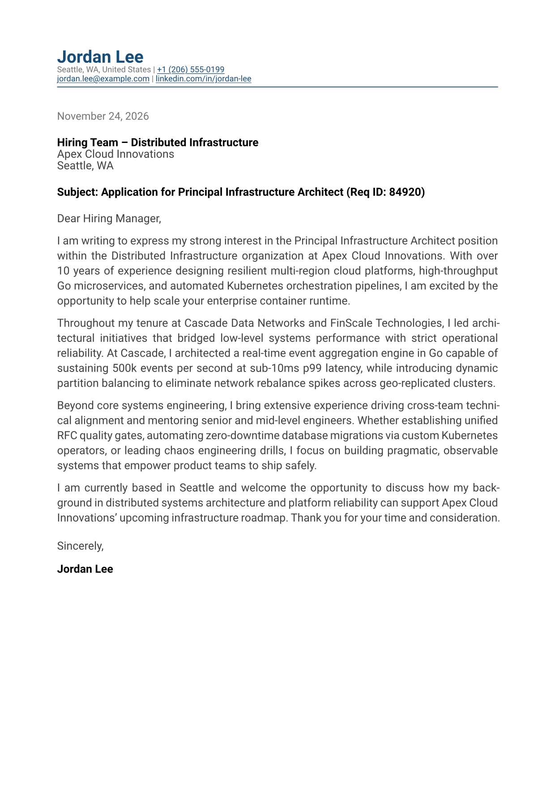

# Typst Compact CV & Cover Letter

A modern, highly modular, and ATS-friendly 2-page curriculum vitae and matching 1-page cover letter template suite engineered in [Typst](https://typst.app/).

Designed for engineers, researchers, and technical professionals who need strict page-budget control, cohesive visual branding across application documents, and programmatic spacing adjustments without visual fragility.

---

## 📑 Preview

### Curriculum Vitae (`template.typ`)

<p align="center">
  
  
</p>

### Cover Letter (`cover-letter.typ`)

<p align="center">
  
</p>

---

## ✨ Features

- **Strict 2-Page Budgeting:** Proportional spacing designed to distribute content naturally across exactly two pages.
- **Dynamic Density Scaling (`density`):** Adjust a single factor (`0.7` – `1.3`) to scale macro breathing room while keeping line heights and micro-spacing readability-locked.
- **Three-Tier Entry Headers (`cv_entry`):** Modular header architecture supporting title/date, organization/location, and an optional third-row explanatory `note` for organizational or project context.
- **Dual-Level Structured Lists:** Dedicated function support for parent achievements and indented sub-item checklists (`cv_entry`).
- **ATS-Optimized Parsing:** Single-column layout with standard text layers, clean text headings, and zero fragile floating frames.
- **Matching Cover Letter Template (`cover-letter.typ`):** Clean, single-page cover letter layout sharing the exact same color palette, typography, and inline link utilities via `common.typ`.
- **Custom Visual Branding:** Dynamic theme palette injection (`accent-color`, `text-color`, `muted-color`) via top-level parameters or reusable layout dictionaries.
- **Zero Heavy Dependencies:** Compiles natively via standard Typst CLI in milliseconds.

---

## 📂 Repository Structure

```text
├── common.typ                # Shared color palette, typography, and inline link utilities
├── template.typ              # 2-page CV template (100% backward-compatible)
├── cover-letter.typ          # 1-page matching cover letter template
├── cv-sample.typ             # Complete CV usage example
└── cover-letter-sample.typ   # Complete cover letter usage example
```

---

## 🚀 Getting Started

### Prerequisites

Install the Typst CLI using official instructions on [https://typst.app/open-source/#download](https://typst.app/open-source/#download)

### Compilation

Clone the repository and compile the sample documents:

```bash
# Compile CV sample to PDF
typst compile cv-sample.typ cv.pdf

# Compile Cover Letter sample to PDF
typst compile cover-letter-sample.typ cover-letter.pdf

# Watch mode for live preview during editing
typst watch cv-sample.typ cv.pdf

```

---

## ⚙️ Configuration & Layout API

All layout parameters are strictly optional and merge on top of the built-in defaults.

```typst
#show: cv.with(
  name: "Your Name",
  address: "City, Country",
  phones: ("+1 234 567 890",),
  emails: ("your.email@example.com",),
  links: (
    (url: "https://linkedin.com/in/username", display: "linkedin.com/in/username"),
  ),
  paper: "a4",         // "a4" | "us-letter"
  font-size: 9.5pt,    // Global typographic base size
  line-leading: 0.35em,// Global paragraph leading
  accent-color: rgb(24, 76, 120), // Primary theme accent color
  layout: (
    density: 1.0,      // Master vertical compression factor (0.7 to 1.3)
    // Optional fine-grained overrides:
    entry-between-entries-gap: 1.0em,
    section-title-above: 1.4em,
  ),
)
```

### Full Layout Parameter Reference

| Parameter                     | Default                                    | Category    | Description                                                                     |
| ----------------------------- | ------------------------------------------ | ----------- | ------------------------------------------------------------------------------- |
| `density`                     | `1.0`                                      | Macro Scale | Multiplier for macro breathing spaces (`< 1.0` tightens, `> 1.0` relaxes).      |
| `page-margin`                 | `(x: 0.75in, top: 0.65in, bottom: 0.65in)` | Geometry    | Page edge boundaries dictionary.                                                |
| `name-to-contacts-gap`        | `0.8em`                                    | Header      | Space between author name and contact rows (scales with density).               |
| `contact-details-font-scale`  | `0.9em`                                    | Header      | Font size scaling relative to document base font size.                          |
| `contact-rows-gap`            | `0.35em`                                   | Header      | Vertical separation between stacked contact lines.                              |
| `section-title-above`         | `1.4em`                                    | Sections    | Margin before section titles (scales with density).                             |
| `section-title-below`         | `0.6em`                                    | Sections    | Padding directly beneath section divider line (scales with density).            |
| `entry-between-entries-gap`   | `1.0em`                                    | Entries     | Vertical gap separating individual CV entries (scales with density).            |
| `entry-header-to-body-gap`    | `0.85em`                                   | Entries     | Space between entry header rows and the bullet body.                            |
| `entry-title-to-subtitle-gap` | `0.35em`                                   | Entries     | Row gutter between entry title and organization/role subtitle (or note).        |
| `entry-subtitle-to-note-gap`  | `0.3em`                                    | Entries     | Row gutter between entry subtitle/location and optional third-row note.         |
| `entry-note-line-leading`     | `0.3em`                                    | Entries     | Line leading inside multi-line third-row explanatory notes.                     |
| `entry-list-spacing`          | `0.7em`                                    | Lists       | Spacing between top-level bullet achievements.                                  |
| `entry-list-body-indent`      | `0.4em`                                    | Lists       | Indentation for bullet body text.                                               |
| `entry-sublist-spacing`       | `0.35em`                                   | Sub-lists   | Vertical spacing between nested checklist sub-bullets.                          |
| `entry-sublist-gap-above`     | `0.25em`                                   | Sub-lists   | Clearance space above nested checklist sub-bullets.                             |
| `entry-sublist-gap-below`     | `0.35em`                                   | Sub-lists   | Clearance space following the completion of a sub-list.                         |
| `root-list-item-gap`          | `0.95em`                                   | Root Lists  | Vertical spacing for root lists like Skills/Publications (scales with density). |
| `root-list-line-leading`      | `0.45em`                                   | Root Lists  | Line height within Skills/Publications list items.                              |
| `root-list-marker-size`       | `0.75em`                                   | Root Lists  | Visual scale of the root list marker symbol.                                    |
| `root-list-body-indent`       | `0.5em`                                    | Root Lists  | Indentation for root list body blocks.                                          |

### Content Functions API

```typst
// Section heading with bottom accent rule
#cv_summary(title: "Professional Summary")[
  Concise overview of technical background and core strengths.
]

#cv_section("Professional Experience")

// Structured entry with optional subtitle, location, third-row note, and nested bullets
#cv_entry(
  title: "Role or Degree Title",
  subtitle: "Organization or Institution",
  location: "City, Country",
  date: "Jan 2024 – Present",
  note: "Optional context line describing team scope, organization domain, or grant.",
  breakable: false,
)[
  - Primary achievement bullet
    - Indented sub-item detail
]

// Inline semantic link helpers (standardized formatting across header and body)
#cv_link("https://doi.org/10.1109/example", display: "10.1109/example")
#cv_link("https://github.com/username")
#cv_email("contact@example.com")
#cv_phone("+1 (206) 555-0199")
```

---

## ✉️ Cover Letter API (`cover-letter.typ`)

```typst
#import "cover-letter.typ": cover_letter, cv_link, cv_email, cv_phone

#show: cover_letter.with(
  name: "Your Name",
  address: "City, Country",
  phones: ("+1 234 567 890",),
  emails: ("your.email@example.com",),
  links: (
    (url: "https://linkedin.com/in/username", display: "linkedin.com/in/username"),
  ),
  date: "November 24, 2026",
  recipient-name: "Hiring Manager / Team Name",
  recipient-org: "Organization Name",
  recipient-address: "City, Country",
  subject: "Application for Role Title (Req ID: 12345)",
  salutation: "Dear Hiring Manager,",
  closing: "Sincerely,",
  paper: "a4",
  font-size: 10pt,
  layout: (
    density: 1.0,
    body-line-leading: 0.42em,
  ),
)

First paragraph introducing the target role and core value proposition...
```

### Cover Letter Layout Parameters

| Parameter                   | Default                                    | Category    | Description                                                                           |
| --------------------------- | ------------------------------------------ | ----------- | ------------------------------------------------------------------------------------- |
| `density`                   | `1.0`                                      | Macro Scale | Multiplier for vertical gaps and body line leading (`< 1.0` tightens).                |
| `page-margin`               | `(x: 0.85in, top: 0.75in, bottom: 0.75in)` | Geometry    | Page edge boundaries dictionary.                                                      |
| `header-name-size`          | `18.5pt`                                   | Header      | Fixed font size for the applicant name (independent of body `font-size`).             |
| `header-contact-size`       | `8.8pt`                                    | Header      | Fixed font size for the two-row contact details (independent of body `font-size`).    |
| `name-to-contacts-gap`      | `4pt`                                      | Header      | Vertical gap between applicant name and contact rows.                                 |
| `contact-rows-gap`          | `3.5pt`                                    | Header      | Vertical gap between row 1 (location/phone) and row 2 (email/links).                  |
| `header-rule-above`         | `6pt`                                      | Header      | Space between contact rows and the horizontal accent rule.                            |
| `header-rule-below`         | `1.5em`                                    | Header      | Space below the horizontal header rule (scales with density).                         |
| `date-to-recipient-gap`     | `1.1em`                                    | Metadata    | Gap between date and recipient block (scales with density).                           |
| `recipient-line-leading`    | `0.32em`                                   | Metadata    | Line leading inside the multi-line recipient address block.                           |
| `recipient-to-subject-gap`  | `1.1em`                                    | Metadata    | Gap between recipient block and `Subject:` line (scales with density).                |
| `subject-to-salutation-gap` | `1.1em`                                    | Metadata    | Gap between `Subject:` line and salutation (scales with density).                     |
| `salutation-to-body-gap`    | `0.85em`                                   | Body        | Gap between salutation and opening paragraph (scales with density).                   |
| `body-line-leading`         | `0.42em`                                   | Body        | Line leading inside body paragraphs (scales with density).                            |
| `paragraph-spacing`         | `0.85em`                                   | Body        | Vertical spacing between body paragraphs (scales with density).                       |
| `body-to-closing-gap`       | `1.2em`                                    | Signature   | Space between last paragraph and closing phrase (scales with density).                |
| `closing-to-signature-gap`  | `0.9em`                                    | Signature   | Space between closing phrase (`Sincerely,`) and signature name (scales with density). |

### Customizing Colors

Override theme colors directly via `cv.with` or `cover_letter.with` parameters (or pass a reusable dictionary via `layout`) without modifying the core templates:

```typst
#show: cv.with( // or cover_letter.with(...)
  name: "Your Name",
  accent-color: rgb("#1a5276"), // Primary accent (headings, rules, bullets)
  text-color: rgb(64, 64, 64),   // Main body text color
  muted-color: rgb(115, 115, 115), // Subtitles and auxiliary details
  // ...
)

```

---

## 📄 License

Distributed under the [MIT License](LICENSE).
