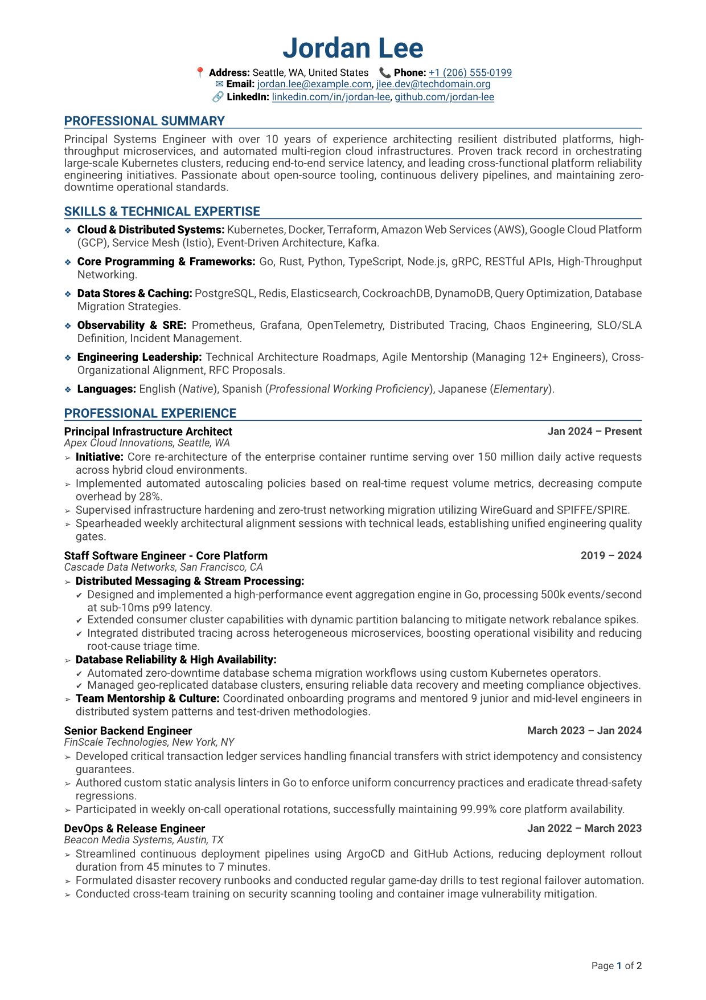
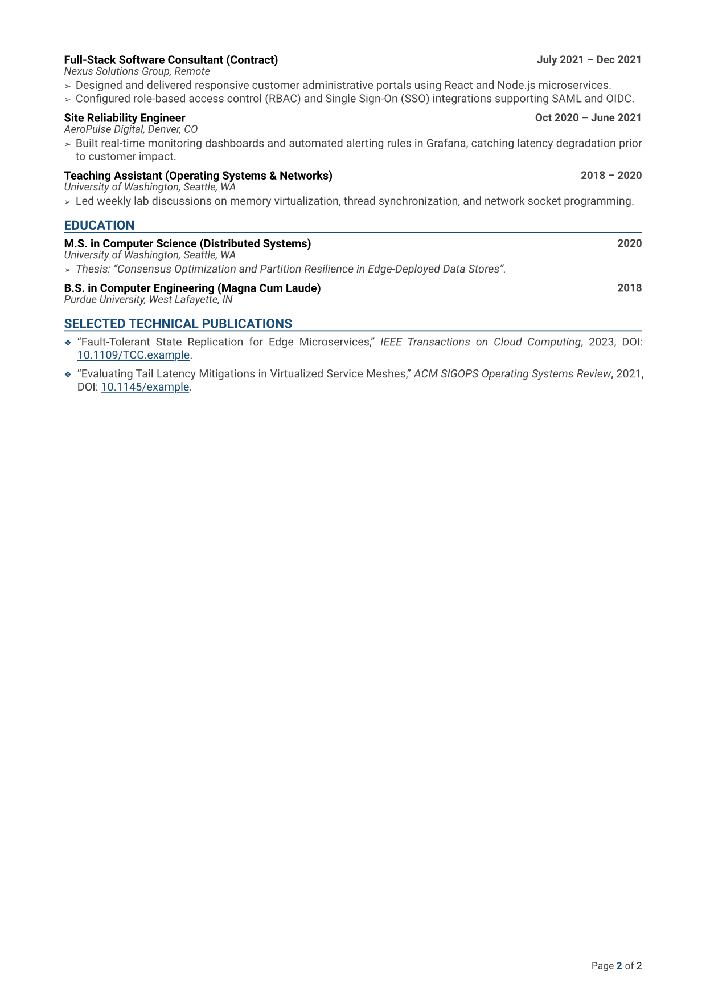

# Typst Compact CV

A modern, highly modular, and ATS-friendly 2-page curriculum vitae template engineered in [Typst](https://typst.app/).

Designed for engineers, researchers, and technical professionals who need strict page-budget control, crisp typographic hierarchy, and programmatic spacing adjustments without visual fragility.

---

## 📑 Preview

<p align="center">
  
  
</p>

---

## ✨ Features

- **Strict 2-Page Budgeting:** Proportional spacing designed to distribute content naturally across exactly two pages.
- **Dynamic Density Scaling (`density`):** Adjust a single factor (`0.7` – `1.3`) to scale macro breathing room while keeping line heights and micro-spacing readability-locked.
- **Dual-Level Structured Lists:** Dedicated function support for parent achievements and indented sub-item checklists (`cv_entry`).
- **ATS-Optimized Parsing:** Single-column layout with standard text layers, clean text headings, and zero fragile floating frames.
- **Custom Visual Branding:** Dynamic theme palette injection (`accent-color`, `text-color`, `muted-color`) via template parameters.
- **Zero Heavy Dependencies:** Compiles natively via standard Typst CLI in milliseconds.

---

## 🚀 Getting Started

### Prerequisites

Install the Typst CLI using official instructions on [https://typst.app/open-source/#download](https://typst.app/open-source/#download)

### Compilation

Clone the repository and compile the sample document:

```bash
# Compile to PDF
typst compile cv-sample.typ cv.pdf

# Watch mode for live preview during editing
typst watch cv-sample.typ cv.pdf

```

---

## ⚙️ Configuration & Layout API

All layout parameters are strictly optional and merge on top of the built-in defaults.

```typst
#show: cv.with(
  name: "Your Name",
  address: "City, Country",
  phones: ("+1 234 567 890",),
  emails: ("your.email@example.com",),
  links: (
    (url: "https://linkedin.com/in/username", display: "linkedin.com/in/username"),
  ),
  paper: "a4",         // "a4" | "us-letter"
  font-size: 9.5pt,    // Global typographic base size
  line-leading: 0.35em,// Global paragraph leading
  accent-color: rgb(24, 76, 120), // Primary theme accent color
  layout: (
    density: 1.0,      // Master vertical compression factor (0.7 to 1.3)
    // Optional fine-grained overrides:
    entry-between-entries-gap: 1.0em,
    section-title-above: 1.4em,
  ),
)
```

### Full Layout Parameter Reference

| Parameter                     | Default                                    | Category    | Description                                                                     |
| ----------------------------- | ------------------------------------------ | ----------- | ------------------------------------------------------------------------------- |
| `density`                     | `1.0`                                      | Macro Scale | Multiplier for macro breathing spaces (`< 1.0` tightens, `> 1.0` relaxes).      |
| `page-margin`                 | `(x: 0.75in, top: 0.65in, bottom: 0.65in)` | Geometry    | Page edge boundaries dictionary.                                                |
| `name-to-contacts-gap`        | `0.8em`                                    | Header      | Space between author name and contact rows (scales with density).               |
| `contact-details-font-scale`  | `0.9em`                                    | Header      | Font size scaling relative to document base font size.                          |
| `contact-rows-gap`            | `0.35em`                                   | Header      | Vertical separation between stacked contact lines.                              |
| `section-title-above`         | `1.4em`                                    | Sections    | Margin before section titles (scales with density).                             |
| `section-title-below`         | `0.6em`                                    | Sections    | Padding directly beneath section divider line.                                  |
| `entry-between-entries-gap`   | `0.95em`                                   | Entries     | Vertical gap separating individual CV entries (scales with density).            |
| `entry-header-to-body-gap`    | `0.55em`                                   | Entries     | Space between entry titles/dates and the bullet body.                           |
| `entry-title-to-subtitle-gap` | `0.3em`                                    | Entries     | Row gutter between entry title and organization/role subtitle.                  |
| `entry-list-spacing`          | `0.48em`                                   | Lists       | Spacing between top-level bullet achievements.                                  |
| `entry-list-body-indent`      | `0.4em`                                    | Lists       | Indentation for bullet body text.                                               |
| `entry-sublist-gap-above`     | `0.25em`                                   | Sub-lists   | Clearance space above nested checklist sub-bullets.                             |
| `entry-sublist-gap-below`     | `0.35em`                                   | Sub-lists   | Clearance space following the completion of a sub-list.                         |
| `root-list-item-gap`          | `0.95em`                                   | Root Lists  | Vertical spacing for root lists like Skills/Publications (scales with density). |
| `root-list-line-leading`      | `0.45em`                                   | Root Lists  | Line height within Skills/Publications list items.                              |
| `root-list-marker-size`       | `0.75em`                                   | Root Lists  | Visual scale of the root list marker symbol.                                    |
| `root-list-body-indent`       | `0.5em`                                    | Root Lists  | Indentation for root list body blocks.                                          |

### Customizing Colors

Override theme colors directly via `cv.with` parameters without modifying the core template:

```typst
#show: cv.with(
  name: "Your Name",
  accent-color: rgb("#1a5276"), // Primary accent (headings, rules, bullets)
  text-color: rgb(64, 64, 64),   // Main body text color
  muted-color: rgb(115, 115, 115), // Subtitles and auxiliary details
  // ...
)

```

---

## 📄 License

Distributed under the [MIT License](LICENSE).
